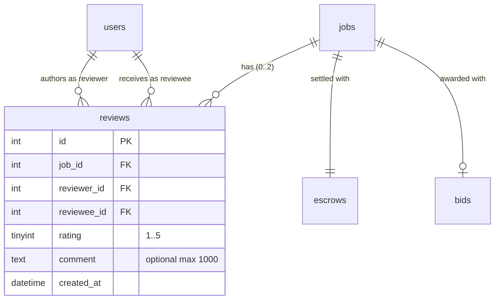
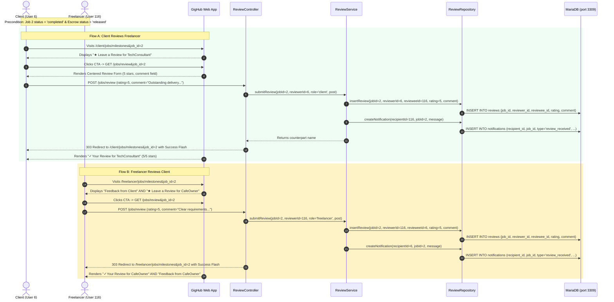

# Module 17: Two-Way Reviews & Ratings MVP

## 1. Objectives and Scope

Module 17 delivers the verified reputation and feedback phase of the GigHub freelance project lifecycle. Following successful simulated escrow release and job completion (Module 16), both transaction participants can leave a verified, public, and immutable rating and testimonial for one another.

### Core Objectives
1. **Two-Way Feedback**: Allow the job-owning Client to review the winning Freelancer, and the winning Freelancer to review the Client.
2. **Verified Reviews Only**: Constrain review eligibility strictly to successfully completed freelance projects (`jobs.status = 'completed'`).
3. **One Review per Party per Job**: Enforce that each participant may submit at most one review per completed job (`UNIQUE(job_id, reviewer_id)`).
4. **Immediate Publication**: Publish submitted reviews immediately upon completion of the atomic submission transaction.
5. **Application-Level Immutability**: Prohibit review editing, deletion, or modification at the application level to preserve authentic reputation records.
6. **Reputation Metrics**: Compute dynamic aggregate reputation ratings (average rating and review count) on public freelancer profiles without storing denormalized or stale averages in the database.
7. **Workspace & Profile Visibility**: Render submitted review cards in both Client and Freelancer milestone workspaces and display verified client testimonials on public freelancer profiles.

---

## 2. Database Schema and Relationships

Module 17 required **zero schema migrations**, operating against the existing pre-provisioned `reviews` table and `notifications` ENUM list in MariaDB (`gighub_dev`):

### `reviews` Table Definition
```sql
CREATE TABLE `reviews` (
  `id` INT(10) UNSIGNED NOT NULL AUTO_INCREMENT,
  `job_id` INT(10) UNSIGNED NOT NULL,
  `reviewer_id` INT(10) UNSIGNED NOT NULL,
  `reviewee_id` INT(10) UNSIGNED NOT NULL,
  `rating` TINYINT(3) UNSIGNED NOT NULL,
  `comment` TEXT DEFAULT NULL,
  `created_at` DATETIME NOT NULL DEFAULT CURRENT_TIMESTAMP,
  PRIMARY KEY (`id`),
  UNIQUE KEY `uq_reviews_job_reviewer` (`job_id`, `reviewer_id`),
  KEY `idx_reviews_reviewee` (`reviewee_id`),
  CONSTRAINT `fk_reviews_job` FOREIGN KEY (`job_id`) REFERENCES `jobs` (`id`) ON DELETE CASCADE,
  CONSTRAINT `fk_reviews_reviewer` FOREIGN KEY (`reviewer_id`) REFERENCES `users` (`id`) ON DELETE CASCADE,
  CONSTRAINT `fk_reviews_reviewee` FOREIGN KEY (`reviewee_id`) REFERENCES `users` (`id`) ON DELETE CASCADE,
  CONSTRAINT `ck_reviews_rating` CHECK (`rating` BETWEEN 1 AND 5),
  CONSTRAINT `ck_reviews_parties` CHECK (`reviewer_id` != `reviewee_id`)
) ENGINE=InnoDB DEFAULT CHARSET=utf8mb4 COLLATE=utf8mb4_unicode_ci;
```

### Table Relationships


---

## 3. Two-Way Review Workflows

The review lifecycle proceeds independently for each party once the job status transitions to `completed`:



---

## 4. Eligibility and Authorization Rules

Before granting access to the review form or executing an insertion, `ReviewService::submitReview()` validates eligibility under row locks:

1. **Authentication & Active Status**:
   - The user must be authenticated, active (`users.status = 'active'`), and email-verified (`users.email_verified_at IS NOT NULL`).
2. **Job Existence & State**:
   - The job must exist and have status `completed` (`jobs.status = 'completed'`).
   - Draft, open, awarded, in-progress, under-review, disputed, or cancelled jobs are rejected with `409 Conflict`.
3. **Participant Membership**:
   - The user must be either the job's owning Client (`jobs.client_id = $userId`) or the awarded Freelancer (`bids.freelancer_id = $userId` from `jobs.awarded_bid_id`).
   - Unrelated users, non-awarded bidders, and administrators receive `403 Forbidden`.
4. **Self-Review Prevention**:
   - Reviews between identical user accounts are strictly forbidden by database constraint (`ck_reviews_parties: reviewer_id != reviewee_id`) and service guard assertions.
5. **No Existing Review**:
   - The acting user must not have already submitted a review for this job (`ReviewRepository::getReview(...) === false`). Repeat submissions are rejected with `409 Conflict`.

---

## 5. Review Submission Transaction & Concurrency

Review insertion is executed within an atomic database transaction with strict row-level lock ordering to prevent race conditions:

```php
$this->pdo->beginTransaction();
try {
    // 1. Lock job context row to prevent state mutations
    $job = $this->repo->getJobContext($jobId, true); // SELECT ... FOR UPDATE

    // 2. Lock and check if a review already exists for this reviewer & job
    $existing = $this->repo->getReview($jobId, $reviewerId, true); // SELECT ... FOR UPDATE
    if ($existing !== false) {
        $this->pdo->rollBack();
        throw new ReviewException(409, 'You have already submitted a review for this project.');
    }

    // 3. Insert review record
    $reviewId = $this->repo->insertReview($jobId, $reviewerId, $revieweeId, $rating, $comment);

    // 4. Queue in-app notification in same transaction
    $this->repo->createNotification($revieweeId, $jobId, $notifMsg);

    $this->pdo->commit();
} catch (Throwable $e) {
    if ($this->pdo->inTransaction()) {
        $this->pdo->rollBack();
    }
    // Specific translation of concurrent DB unique violation to 409 Conflict
    $code = (string)$e->getCode();
    if ($code === '23000' || ($e->errorInfo[1] ?? 0) === 1062) {
        throw new ReviewException(409, 'You have already submitted a review for this project.');
    }
    throw $e;
}
```

---

## 6. Duplicate Prevention and Concurrency Handling

Duplicate reviews are defended against at two distinct architectural levels:
1. **Application Level**: Pre-insertion verification with `SELECT ... FOR UPDATE` locks guarantees that sequential or slightly offset double-submits encounter an immediate `409 Conflict`.
2. **Database Level**: The table-level unique constraint `uq_reviews_job_reviewer UNIQUE(job_id, reviewer_id)` guarantees that even in extreme parallel race conditions, MySQL/MariaDB rejects the second insert with SQLSTATE `23000` (Error 1062).
3. **Safe Exception Translation**: `ReviewService` catches PDO unique constraint violations, rolls back the transaction, and maps them to a user-friendly `409 Conflict` rather than exposing raw database exceptions.

---

## 7. Application-Level Immutability

> [!NOTE]
> **Immutability Architecture**: Reviews in GigHub are immutable **at the application level**. There are no controller actions, HTTP endpoints, or service methods for editing, updating, retracting, or deleting reviews. However, the database table permissions for the application user (`gighub_app`) include `UPDATE` as part of standard application privileges, so immutability is enforced through application design and routing rules rather than database-level trigger locks.

Once a review is submitted:
- It cannot be updated or amended by the reviewer.
- It cannot be deleted by either party.
- Navigating back to `?route=/jobs/review&job_id={id}` automatically redirects the user back to their workspace with an informational flash message: *"You have already submitted a review for this project."*

---

## 8. Rating and Feedback Validation

Review submissions are validated by `ReviewSubmissionValidator::validate()`:

| Field | Type | Rule | Validation Behavior |
| :--- | :--- | :--- | :--- |
| `rating` | Integer | Required, `1..5` | Must parse to integer in range 1 to 5. Values outside return `422 Unprocessable Entity` ("Please select a rating between 1 and 5 stars."). |
| `comment` | String | Optional, max 1,000 UTF-8 chars | Trimmed. Empty strings normalized to `null`. Length exceeding 1,000 characters returns `422 Unprocessable Entity` ("Review comment cannot exceed 1,000 characters."). |

---

## 9. Verified Freelancer Reputation Calculation

Freelancer reputation metrics are calculated dynamically on read without caching or storing denormalized aggregates:

```sql
SELECT COUNT(r.id) AS total_count, ROUND(AVG(r.rating), 1) AS average_rating
FROM reviews r
JOIN jobs j ON j.id = r.job_id AND j.status = 'completed' AND j.client_id = r.reviewer_id
JOIN bids b ON b.id = j.awarded_bid_id AND b.freelancer_id = r.reviewee_id
WHERE r.reviewee_id = ?;
```

### Critical Reputation Invariants:
1. **Client Reviews Only**: The query strictly requires `j.client_id = r.reviewer_id`. A Freelancer's review of a Client **never** counts toward the Freelancer's own rating or review count.
2. **Completed Jobs Only**: The query requires `j.status = 'completed'`, ensuring only verified, fully-settled projects contribute to public reputation.
3. **Empty State Handling**: When `total_count = 0`, `average_rating` is `null`, rendering an empty state message on the profile rather than `0.0`.

---

## 10. Review Publication and Notification Behavior

1. **Instant Publication**: Reviews become visible immediately in workspaces and on public profiles upon transaction commit.
2. **In-App Notification**: An in-app notification is queued atomically in the same transaction:
   - Recipient: Counterpart user ID (`reviewee_id`).
   - Type: `'review_received'`.
   - Message: `New review received for "{Job Title}" from {Reviewer Name} ({Rating}/5 stars).`
   - Job ID: Linked directly to the completed project.

---

## 11. Review Form and Workspace UI Integration

### Centered Review Form Layout
The review page (`?route=/jobs/review&job_id={id}`) uses a dedicated centered layout:
- **Container**: `.gh-review-layout` with `max-width: 780px; margin: 2rem auto 4rem; padding: 0 1.25rem;`.
- **Form Card**: `.gh-review-form-card` takes full width of container (`100%`) with internal left-aligned inputs.
- **Star Controls**: Interactive star rating radio group (`5..1` display via `flex-direction: row-reverse`) with keyboard navigation (`tab` and arrow keys) and ARIA radiogroup semantics.
- **Responsive Behavior**: Fluid scaling on desktop, tablet, and mobile screens. On screens `< 480px`, action buttons expand to full width.

### Workspace Review Presentation
On completed milestone workspaces (`/client/jobs/milestones` and `/freelancer/jobs/milestones`):
- **Unreviewed State**: Renders primary CTA button: `★ Leave a Review for {Counterpart Name}`.
- **Submitted Review**: Renders green card: `✓ Your Review for {Counterpart Name}` showing stars, comment, and UTC timestamp.
- **Received Review**: Renders yellow card: `Feedback from {Counterpart Name}` displaying partner feedback.

### Freelancer Public Profile Integration
On public profile pages (`?route=/freelancers/show&id={id}`):
- **Reputation Header**: Renders `★ 5.0 (1 verified review)` next to the freelancer headline.
- **Review History List**: Renders "Client Reviews & Ratings" section with review cards showing star rating, project title, client name, quote, and submission date.

---

## 12. Security Controls

- **Authentication Guard**: `AuthGuard::check()` enforces active authentication; unauthorized requests redirect to `/login` (303) or return `403 Forbidden`.
- **Purpose-Specific CSRF**: Forms require valid `Csrf::token('job_review')`. On submission, tokens are validated and rotated.
- **Post/Redirect/Get (PRG)**: Successful submissions redirect with `303 See Other` to the workspace, preventing form re-submission on refresh.
- **Output Escaping**: All user-supplied fields (`comment`, `display_name`, `job_title`) are strictly escaped via `htmlspecialchars(..., ENT_QUOTES | ENT_SUBSTITUTE, 'UTF-8')`.

---

## 13. Offline Test Coverage & Results

The dedicated offline test suite ([`tests/reviews.php`](file:///c:/xampp/htdocs/GigHub/tests/reviews.php)) contains **147 offline assertions** with mocked PDO connections:

```powershell
C:\xampp\php\php.exe tests\reviews.php
# Output: PASS: 147 reviews offline checks; no database connections.
```

### Full Regression Suite Results (All 11 Suites):
| Suite | File | Checks | Result |
| :--- | :--- | :---: | :---: |
| 1 | `tests/reviews.php` | 147 | **PASS** |
| 2 | `tests/settlement.php` | 152 | **PASS** |
| 3 | `tests/wallet.php` | 50 | **PASS** |
| 4 | `tests/escrow.php` | 60 | **PASS** |
| 5 | `tests/milestones.php` | 81 | **PASS** |
| 6 | `tests/submissions.php` | 252 | **PASS** |
| 7 | `tests/bidding.php` | 99 | **PASS** |
| 8 | `tests/awarding.php` | 55 | **PASS** |
| 9 | `tests/freelancer-profile.php` | 49 | **PASS** |
| 10 | `tests/homepage.php` | 37 | **PASS** |
| 11 | `tests/shared-navigation.php` | 58 | **PASS** |
| **Total** | | **990** | **ALL PASS** |

---

## 14. Actual Manual Acceptance Testing Outcomes

Manual browser acceptance testing was conducted on live development database `gighub_dev` (MariaDB port 3309). Read-only database verification confirmed the exact live state:

1. **Client Review on Job 2**:
   - Reviewer: Client User 6 (`Jason`).
   - Reviewee: Freelancer User 116 (`Jason01`).
   - Rating: `5` stars.
   - Comment: *"Outstanding delivery on the Cafe Ordering System. Clean PHP code and prompt communication!"*
   - Timestamp: `2026-11-05 14:39:13` UTC.
   - Result: Published immediately; in-app notification delivered to Freelancer 116.
2. **Freelancer Review on Job 2**:
   - Reviewer: Freelancer User 116 (`Jason01`).
   - Reviewee: Client User 6 (`Jason`).
   - Rating: `5` stars.
   - Comment: *"Clear requirements and fast deliverable approval. A pleasure to collaborate with!"*
   - Timestamp: `2026-11-05 14:43:09` UTC.
   - Result: Published immediately; in-app notification delivered to Client 6.
3. **Workspace Card Rendering**:
   - Both Client and Freelancer workspaces render their submitted review card and counterpart feedback card side-by-side.
4. **Public Profile Reputation Display**:
   - Profile `?route=/freelancers/show&id=116` renders `★ 5.0 (1 verified review)`.
   - Verified that Review 2 (Freelancer-to-Client) does not bleed into Freelancer User 116's metrics.
5. **Duplicate Prevention**:
   - Direct navigation to `?route=/jobs/review&job_id=2` after reviewing redirected to workspace with info flash message.

---

## 15. Known Limitations & Future Improvements

1. **Client Profile Reputation**: Clients currently do not have a public client profile page. Freelancer-to-Client reviews are stored and visible in the project milestone workspace, but not yet aggregated onto a dedicated public client reputation page.
2. **Blind Review Period**: Reviews are published immediately. A future enhancement could introduce a double-blind review window (e.g., reviews hidden until both parties submit or 14 days elapse).
3. **Review Responses**: Reviewees cannot post a public response or rebuttal to a review.
4. **Disputed Job Reviews**: Reviews are restricted to normal job completion. Disputed or cancelled closures do not qualify for reviews in the MVP.
